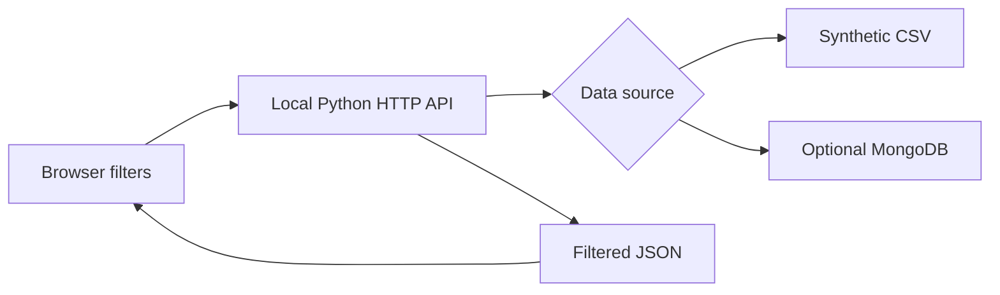

# Animal Rescue Explorer | Local Data Dashboard

**Explore animal records through a filterable local dashboard and a read-only Python HTTP API.**

[](https://github.com/xtyledan/Animal-Rescue-Explorer-Local-Data-Dashboard/actions/workflows/python-tests.yml) · [Screenshot](docs/screenshot.png) · [Engineering notes](docs/INTERVIEW_NOTES.md) · [MIT License](LICENSE)


*Real browser screenshot from the running local server, captured in GitHub Actions. The ten demo animals are synthetic.*

## Problem and solution

Reviewing animal records shouldn't require writing database queries. This project combines a simple browser interface, filtering by animal type, breed and outcome, and summary views. **The bundled CSV makes it runnable without credentials or an external database.**

## Quick start

Requires Python 3.11+; the default sample-data mode uses the standard library.

```bash
git clone https://github.com/xtyledan/Animal-Rescue-Explorer-Local-Data-Dashboard.git
cd Animal-Rescue-Explorer-Local-Data-Dashboard
python standalone_dashboard.py
```

Open **http://127.0.0.1:8080/**. Choose an animal type, enter part of a breed, or select an outcome. Summary counts, breed distribution, animal records and map links update to match. To use another port: `python standalone_dashboard.py --port 8081`.

**API example:**

```bash
curl "http://127.0.0.1:8080/api/animals?animal_type=Dog&breed=Labrador"
```

Returns JSON with matching records and a `source` indicator.

## How it works



| File | Responsibility |
| --- | --- |
| [standalone_dashboard.py](standalone_dashboard.py) | HTTP server, filtering and in-browser visualization |
| [sample_animals.csv](sample_animals.csv) | Clearly labeled fictional demonstration records |
| [crud.py](crud.py) | Optional MongoDB adapter, guarded updates and deletes |
| [tests](tests) | HTTP, filtering and mocked database regression tests |
| [ProjectTwoDashboard.ipynb](ProjectTwoDashboard.ipynb) | Original coursework notebook; separate environment required |

## Tests and optional database

```bash
python -m pip install -r requirements.txt
python -m unittest discover -s tests -v
```

The default dashboard itself does **not** need PyMongo. Install requirements to run the CRUD tests or use MongoDB. For database mode, set the `MONGO_URI` environment variable with your own authorized credentials; it expects the `AAC.animals` collection. Never put secrets into the repository.

[GitHub Actions tests](https://github.com/xtyledan/Animal-Rescue-Explorer-Local-Data-Dashboard/actions/workflows/python-tests.yml) cover the local API and mocked CRUD behavior, not production database connectivity.

## Tradeoffs and limitations

The small CSV keeps the demo reproducible; MongoDB offers persistent records but introduces external configuration. The built-in HTTP server is **for localhost**, not a production deployment: it has no authentication, rate limiting, pagination or hosted demo. Visual browser capture is available, but full end-to-end usability tests are not.

**License:** [MIT](LICENSE). [Portfolio](https://xtyledan.github.io/)
